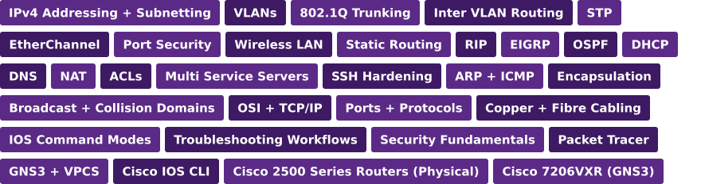
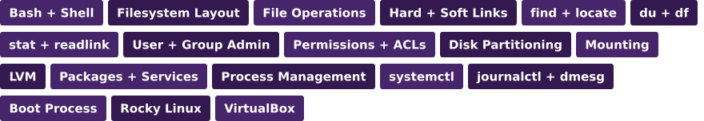

<div align="center">


</div>

```console
sumanth@thro12:~$ whoami
Sumanth R - Computer Science (2026), networking-first fresher

sumanth@thro12:~$ traceroute career-path
 1  CCNA training on physical Cisco 2500-series devices (TBN, Bengaluru)
 2  Enterprise labs in Packet Tracer + GNS3 - hotel, bank and company networks
 3  Linux and AWS fundamentals
 4  Python network automation with Netmiko
 5  target: junior network engineer -> automation -> data-centre networking

sumanth@thro12:~$ ping recruiters --count 1
64 bytes of curiosity: icmp_seq=1 ttl=64 - open to junior networking / cloud roles
```

```console
sumanth@thro12:~$ cat about.md
CCNA preparation nearing completion - trained hands-on, not yet certified
7 Cisco Networking Academy course badges earned
Juniper track is the next goal
I like my networks redundant, my configs version-controlled,
and my labs honest about what passed and what failed
```

## `tcpdump --stats`

<div align="center">


</div>

## `ls skills/`

### `CCNA Skills`



### `Linux Skills`



### `AWS Skills`


### `Automation Skills`


### `learning-next/`


## `ls featured-projects/`

- [**networking-learning**](https://github.com/thro12/networking-learning) - my main lab journal: hotel, bank and three-floor company network builds in Packet Tracer, GNS3 labs, honest test results included (failures documented, not edited out)
- [**networking**](https://github.com/thro12/networking) - networking notes and configs
- [**network-automation**](https://github.com/thro12/network-automation) - Python automation scripts (Netmiko, SSH automation labs)
- [**cloud**](https://github.com/thro12/cloud) / [**aws**](https://github.com/thro12/aws) - cloud and AWS learning track
- Live portfolio: [sumanth-portfolio-nine.vercel.app](https://sumanth-portfolio-nine.vercel.app/)

## `telnet me`

[](https://www.linkedin.com/in/sumanth-r-ml/)
[](https://sumanth-portfolio-nine.vercel.app/)

<div align="center">


</div>
